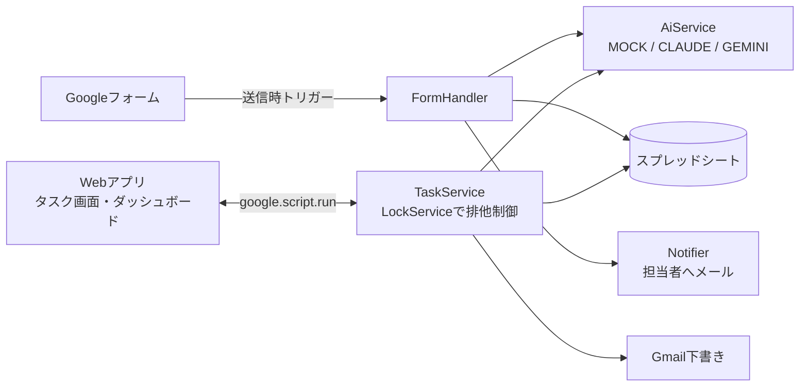

# AI付き 問い合わせ管理ツール(Google Apps Script)

> ※ ポートフォリオ用のデモです。「ひだまりリフォーム株式会社」およびデータ内の氏名・連絡先はすべて架空のものです。

**▶ 触れるデモ(ログイン不要):** https://script.google.com/macros/s/AKfycbxkU3wW6ccoz1pytFHnybWbL8gQHXLW4j3z8m3wWXUwVRZVtN6NYZeQyRbBZ-WGkIkXFQ/exec
(メールは実際には送信されません。データは毎朝4時に最初の状態に戻ります)

ホームページのフォームから届く問い合わせを、**AIが自動で仕分けしてタスク化**し、**担当者の重複対応を防ぎながら**、**返信文の下書きまで作成**する、Google Workspace だけで動く問い合わせ管理ツールです。

---

## 課題 → 解決 → 効果

**想定している会社:** 住宅リフォーム会社(ひだまりリフォーム株式会社・架空)

| 現場の課題 | このツールでの解決 | 効果 |
|---|---|---|
| フォームの回答をスプレッドシートに手で転記している | 送信と同時にシートへ自動登録し、AIが種別・緊急度・要約を判定 | **転記作業がゼロに** |
| 誰が対応したか分からず、同じお客様に2人が連絡してしまう | 「対応する」を押した人が担当として確定。他の人には「〇〇さんが対応中」と表示 | **重複対応・対応漏れの防止** |
| 返信文を毎回ゼロから書いていて、返信が遅れる | AIが返信文の下書きを作成し、確認・修正してGmailの下書きに保存するだけ | **返信文作成の時間を短縮** |
| 問い合わせの傾向が分からない | 件数・種別・対応状況・初動時間をダッシュボードで可視化 | **問い合わせの傾向を数字で把握** |

---

## 機能一覧

### 問い合わせの受付
- Googleフォームからの問い合わせを「問い合わせ」シートに自動登録(`INQ-0001` 形式で採番)
- AIが **種別**(新規相談/見積依頼/工事中の相談/アフター・不具合/クレーム/その他)・**緊急度**(高/中/低)・**要約** を自動判定
- 担当者全員にメールで通知(緊急度「高」は件名の先頭に【至急】)

### タスク管理画面(Webアプリ)
- タブ:未対応/対応中(自分)/対応中(全員)/完了/ダッシュボード(件数バッジつき)
- 未対応は「緊急度の高い順 → 受付の古い順」に表示し、受付からの経過時間も表示
- **対応する**:排他制御(LockService)により、同時に押しても担当は1人だけ
- **返信文を作成**:AIが下書きを作成し、画面上で編集可能
- **Gmailの下書きに保存**:お客様宛ての下書きを作成(誤送信防止のため自動送信はしない)
- **完了にする/担当を外す**:確認ダイアログつき
- 対応メモの記録(引き継ぎ用)
- 30秒ごとの自動更新(入力中の文章は消えない)、スマホ対応、処理中表示とトースト通知

### ダッシュボード
- 今月の問い合わせ件数(先月比)/未対応件数/平均初動時間(受付 → 担当確定)
- 直近14日の日別件数、種別ごとの件数、ステータスごとの件数、担当者ごとの対応件数
- 各グラフの数値を表でも確認可能

### AIの切り替え
| モード | 内容 | 費用 |
|---|---|---|
| `MOCK`(初期値) | キーワードのルールで判定し、種別ごとの定型文で返信文を作成 | 無料 |
| `CLAUDE` | Anthropic API(Claude)で判定・返信文を作成 | 従量課金 |
| `GEMINI` | Google Gemini API で判定・返信文を作成 | 無料枠あり |

APIキーの未設定・通信エラー・回答の形式不正などの場合は、**自動で MOCK に切り替えて処理を止めない**ようにしています(理由はログシートに記録)。

---

## 技術構成

- Google Apps Script(V8)/ Googleスプレッドシート / Googleフォーム / Gmail
- HTML Service(Webアプリ)+ Chart.js
- Anthropic API / Gemini API(UrlFetchApp から呼び出し、JSON形式で回答させる)
- clasp(ローカルで開発し、`clasp push` でGASに反映)



### ディレクトリ構成

```
demo1-inquiry-manager/
├── README.md
├── CLAUDE.md          # 要件定義・開発ルール
├── .gitignore
├── .clasp.json        # clasp設定(Git管理外)
└── src/
    ├── appsscript.json # マニフェスト(タイムゾーン・Webアプリ設定)
    ├── Config.js       # 定数・シート名・列定義・共通関数
    ├── Setup.js        # 初期セットアップ(シート・フォーム・トリガー作成)
    ├── DummyData.js    # ダミーデータの生成・削除
    ├── FormHandler.js  # フォーム送信時の処理
    ├── AiService.js    # AI判定・返信文作成(MOCK / CLAUDE / GEMINI)
    ├── TaskService.js  # タスクの取得・担当確定・ステータス更新
    ├── Notifier.js     # メール通知
    ├── WebApp.js       # doGet と画面から呼ばれる関数
    ├── index.html      # メイン画面
    ├── css.html        # スタイル
    └── js.html         # 画面側スクリプト
```

### シート構成
| シート | 内容 |
|---|---|
| 問い合わせ | 問い合わせID・受付日時・お客様情報・本文・AI判定結果・ステータス・担当者・各日時・対応メモ・返信下書き・AI判定モード |
| 担当者 | 担当者名・通知先メールアドレス・得意な種別 |
| 設定 | 会社名・返信メールの署名・通知のON/OFF |
| ログ | 日時・処理名・結果・エラー内容(最新2,000行を保持) |
| フォーム回答(原本) | フォームの回答そのもの(バックアップ) |

---

## セットアップ手順

### 1. 開発環境の準備
1. [Node.js](https://nodejs.org)(LTS版)をインストール
2. clasp をインストール:`npm install -g @google/clasp`
3. [Apps Script の設定画面](https://script.google.com/home/usersettings) で「Google Apps Script API」をオン
4. `clasp login` でGoogleアカウントにログイン

### 2. スプレッドシートとスクリプトの紐付け
1. 新しいGoogleスプレッドシートを作成し、「拡張機能」→「Apps Script」を開く
2. 「プロジェクトの設定」から **スクリプトID** をコピー
3. プロジェクト直下に `.clasp.json` を作成
   ```json
   { "scriptId": "コピーしたスクリプトID", "rootDir": "src" }
   ```
4. コードを反映:`clasp push --force`

### 3. 初期セットアップ(Apps Script エディタで実行)
1. `setup` を実行(初回は権限を承認)
   → シート・フォーム・送信時トリガー・架空の担当者4名が作成され、実行ログにフォームのURLが表示されます
2. (任意)`generateDummyData` を実行 → 過去30日分・40件のダミーデータを作成
   - 削除するときは `clearDummyData`(フォームから届いた問い合わせは消えません)
3. `testFormSubmit` を実行 → テスト用の問い合わせが1件登録され、通知メールが届けば成功(Gmailの権限承認も兼ねる)

### 4. Webアプリとして公開
1. 「デプロイ」→「新しいデプロイ」→ 種類「ウェブアプリ」
2. 次のユーザーとして実行:**自分**/アクセスできるユーザー:**Google アカウントを持つ全員**
3. 表示されたURLを担当者に共有
   - コードを修正したら「デプロイを管理」→ 編集 →「新バージョン」で更新(URLは変わりません)

### 5.(任意)AI APIを使う
「プロジェクトの設定」→「スクリプト プロパティ」に登録します。何も登録しなければ MOCK で動きます。

| プロパティ | 値 | 備考 |
|---|---|---|
| `AI_PROVIDER` | `MOCK` / `CLAUDE` / `GEMINI` | 未設定時は `MOCK` |
| `ANTHROPIC_API_KEY` | Anthropic のAPIキー | [Anthropic Console](https://console.anthropic.com) で発行 |
| `GEMINI_API_KEY` | Gemini のAPIキー | [Google AI Studio](https://aistudio.google.com) で発行 |
| `CLAUDE_MODEL` | 例:`claude-haiku-4-5` | 任意。未設定時は `claude-opus-5-5` |
| `GEMINI_MODEL` | 例:`gemini-3.8-flash` | 任意。未設定時は `gemini-3.8-flash` |

登録後、エディタで `testAiConnection` を実行し、実行ログの `mode` が `CLAUDE` / `GEMINI` になっていれば成功です。

> `SPREADSHEET_ID` / `FORM_ID` / `DUMMY_IDS` は `setup` などが自動で登録する値です。変更しないでください。

---

### 6. 公開デモ(ログインなしで誰でも触れる版)

ポートフォリオで発注者に触ってもらうための版です。手元の版とは別のスプレッドシート・別のスクリプトで動かします。

**安全のための作り**
- 使える権限を `public/appsscript.json` で最小限にしています(このスプレッドシート1枚・フォーム・時刻のトリガーだけ)。Gmail・ドライブ・外部への通信の権限は持たせていないので、画面からどんな操作をされても、メールの送信やドライブの読み取りはできません
- メール通知と Gmail の下書きは行わず、「送信記録(デモ)」シートに残すだけにしています
- AI は API を使わない MOCK に固定しています(費用がかかりません)
- 毎朝4時にデータを最初の状態に戻します
- 画面の上に「ポートフォリオ用のデモです」と表示します

**組み立てと更新**
```
bin/build-public.sh          # build/public に組み立てる(Gmail を呼ばないことを自動で確認)
bin/build-public.sh --push   # 組み立てて公開デモのスクリプトに送り、公開中の Web アプリも更新する
```
- 公開デモ用の scriptId は `.clasp.public.json`、公開中のデプロイの ID は `.public-deployment-id` に置きます(どちらも Git には入れません)
- 初めて作るときは、Apps Script エディタで `setupPublicDemo()` を1回実行して権限を許可します

## 使い方(担当者向け)

1. WebアプリのURLを開き、画面上部の **「あなたの名前」** を選ぶ(次回からは自動で選ばれます)
2. **未対応** タブで、上から順に問い合わせを確認(赤い線は緊急度「高」)
3. カードをクリックして内容を確認し、**「対応する」** を押す
   - 「〇〇さんが対応中です」と出たら、すでに他の人が担当しています
4. **「返信文を作成」** → 内容を確認・修正 → **「Gmailの下書きに保存」**
5. Gmail の下書きを開いて内容を確認し、送信する
6. 対応が終わったら **「完了にする」**。経過は **対応メモ** に残す
7. 間違えて担当になったときは **「担当を外す」** で未対応に戻す

管理者向け:会社名・署名・通知のON/OFFは「設定」シート、担当者の追加は「担当者」シートで変更できます。

---

## 工夫した点

- **重複対応の防止**:LockService で排他制御し、書き込みの直前にシートを読み直して担当者を確認
- **止まらないAI連携**:APIの失敗や想定外の回答は MOCK に自動で切り替え、理由をログに記録
- **AIの回答を構造化**:Claude は構造化出力、Gemini は responseSchema でJSON形式に固定し、値も検証
- **安全面**
  - お客様の入力が数式として実行されないよう、`=` などで始まる文字列はテキストとして保存
  - 問い合わせ本文はタグで囲み、本文中の指示にAIが従わないよう指示(プロンプトインジェクション対策)
  - 返信は Gmail の下書き作成までにとどめ、誤送信を防止
  - APIキーはスクリプトプロパティに保存し、コードには含めない
- **現場で使いやすい画面**:説明なしで使えるボタン配置、処理中表示による二重送信防止、自動更新でも入力中の文章が消えない設計

---

## 操作動画の台本(約2分)

**撮影前の準備**
- `generateDummyData` を実行しておく(ダッシュボードが見栄えするように)
- 通常ウィンドウ(日向 太郎)とシークレットウィンドウ(森川 花子)でWebアプリを開いておく
- フォームの回答画面と Gmail をタブで開いておく
- 送信する文面:「2階の天井から雨漏りしています。以前屋根の工事をお願いした者です。至急見に来ていただけますか。」

| 時間 | 画面 | 見せること・ナレーション例 |
|---|---|---|
| 0:00〜0:10 | スプレッドシート | 「問い合わせを手で転記し、誰が対応しているか分からない…という課題を解決するツールです」 |
| 0:10〜0:25 | フォーム | 雨漏りの問い合わせを入力して送信 |
| 0:25〜0:40 | シート → Gmail | 自動で登録され、AIが「アフター・不具合/高」と判定。【至急】の通知メールが届く |
| 0:40〜1:00 | Webアプリ(未対応) | 緊急度「高」が一番上に表示。カードを開いて「対応する」 |
| 1:00〜1:10 | シークレットウィンドウ | 同じ問い合わせで「対応する」→「日向 太郎さんが対応中です」と表示され、重複対応を防止 |
| 1:10〜1:30 | Webアプリ → Gmail | 「返信文を作成」→ 少し修正 →「Gmailの下書きに保存」→ Gmail の下書きを見せる |
| 1:30〜1:40 | Webアプリ | 「完了にする」→ 完了タブに移動 |
| 1:40〜1:55 | ダッシュボード | 今月の件数・未対応・平均初動時間、種別やステータスのグラフ |
| 1:55〜2:00 | まとめ | 「転記ゼロ・重複対応防止・返信時間の短縮を、Google Workspace だけで実現します」 |

---

## 提案文で使える紹介文

> Googleフォームに届いた問い合わせを、AIが種別・緊急度・要約を自動判定してタスク化する管理ツールを、Google Apps Script で作成しました。
> 「対応する」ボタンで担当を確定して重複対応を防ぎ、AIが作成した返信文をGmailの下書きに保存できるので、転記作業ゼロ・返信時間の短縮につながります。
> サーバー不要で Google Workspace だけで動き、AIは Claude / Gemini / 無料のルール判定から選べます(デモ動画・ソースコードをご覧いただけます)。
